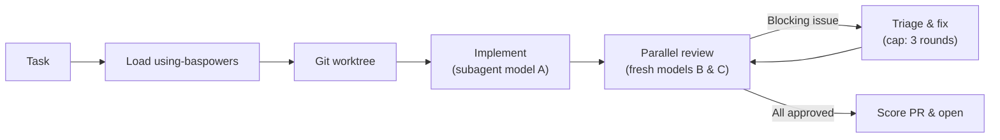

# DevAgent

[](../LICENSE)
[](https://docs.mindroom.chat/configuration/agents/)
[](https://github.com/basnijholt/baspowers)

<picture>
  <source media="(prefers-reduced-motion: no-preference)" srcset="https://raw.githubusercontent.com/mindroom-ai/mindroom/main/assets/logo/logo-mark-animated.svg" />
  
</picture>

A MindRoom development agent modeled after MindRoom's live `DevAgent` — driven by [`baspowers`](https://github.com/basnijholt/baspowers) skills, native cross-model subagents (`run_subagent`), deferred tools, and cache-stable file memory.



## What's inside

| File | Loaded | Purpose |
|---|---|---|
| [`config.yaml`](config.yaml) | Config snippet | MindRoom `agents.dev` setup: self-delegation, deferred tools, file memory, `skill_learning`, `room_activity` |
| [`AGENTS.md`](AGENTS.md) | Every standard turn | Core operating rules, cross-model delegation & review protocol, reply style, hard rules |
| [`MEMORY.md`](MEMORY.md) | Every standard turn | Curated `<200`-line operational lessons (shell/git safety, subagent hygiene, review heuristics) |
| [`ARCHITECTURE.md`](ARCHITECTURE.md) | On demand | Project repos, service ports, verification model |
| [`TOOLS.md`](TOOLS.md) | On demand | Git/forge brokering, browser automation, secrets rules |
| [`skills/`](skills/README.md) | On demand | `baspowers` install guide + starter [`developing-example-app`](skills/developing-example-app/SKILL.md) skill |
| [`memory/`](memory/README.md) | Recall & search | Monthly thread logs (`threads-YYYY-MM.md`) and deeper topic notes |

## Quick start

1. **Copy the workspace** from the repository root (includes `.gitignore`, drops `config.yaml`):

   ```bash
   WORKSPACE=~/.mindroom/mindroom_data/agents/dev/workspace
   mkdir -p "$WORKSPACE"
   cp -R dev-agent/. "$WORKSPACE/" && rm "$WORKSPACE/config.yaml"
   ```

2. **Install `baspowers` skills** as real directories (MindRoom does not follow symlinks inside `skills/`):

   ```bash
   TMP=$(mktemp -d) && git clone --depth 1 https://github.com/basnijholt/baspowers "$TMP" \
     && cp -R "$TMP/skills/"* "$WORKSPACE/skills/" && rm -rf "$TMP"
   ```

3. **Wire it up:** merge [`config.yaml`](config.yaml) into your MindRoom `config.yaml`, then customize `<placeholders>` in `AGENTS.md`, `ARCHITECTURE.md`, `TOOLS.md`, and `skills/developing-example-app/SKILL.md`.

<details>
<summary><b>Key behaviors built into AGENTS.md</b></summary>

- **Minimal always-loaded prompt:** only `AGENTS.md` and `MEMORY.md` preload on standard turns. Minimal-mode subagents (`run_subagent(..., minimal=true)`) skip preloaded files and receive explicit constraints via the task brief or `minimal_instructions`.
- **Cross-model separation:** never has a model review its own code; pairs one implementer model with fresh reviewers from two distinct model families, plus a blind fresh re-reviewer after fixes.
- **Anti-bloat triage & cap:** distinguishes real bugs/regressions from contrived edge cases (declined in a 1-line PR note), and triggers `stopping-runaway-prs` after 2 consecutive rounds with new Majors or 3 rounds total.
- **Deferred tools:** keeps `shell`, `coding`, and `matrix_message` loaded and defers secondary tools (`todo`, `memory`, `browser`, `scheduler`, `workflow`, thread tools, secret helpers) with `defer: true`.
- **Cache-friendly memory:** thread status notes go into `memory/threads-YYYY-MM.md` instead of churning `MEMORY.md`, keeping prompt caches warm across parallel threads.

</details>
